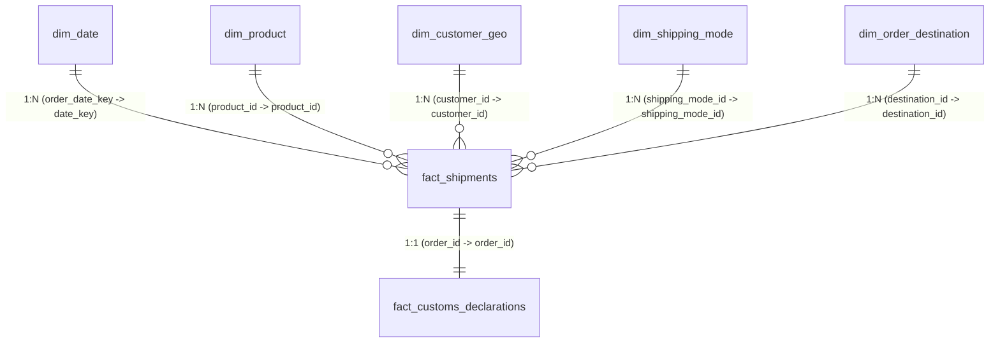

# Power BI Semantic Model & Relationship Specification

This document details the Star Schema data modeling architecture designed for Power BI Desktop.

---

## 1. Relational Diagram & Relationships

### Table Relationships Matrix

| From (Fact Table) | Foreign Key Column | To (Dimension Table) | Primary Key Column | Cardinality | Cross-Filter Direction | Active |
| :--- | :--- | :--- | :--- | :--- | :--- | :--- |
| `fact_shipments` | `order_date_key` | `dim_date` | `date_key` | Many to One (*:1) | Single (`dim_date` filters `fact_shipments`) | Yes |
| `fact_shipments` | `shipping_date_key` | `dim_date` | `date_key` | Many to One (*:1) | Single | No (Inactive, use `USERELATIONSHIP`) |
| `fact_shipments` | `product_id` | `dim_product` | `product_id` | Many to One (*:1) | Single (`dim_product` filters `fact`) | Yes |
| `fact_shipments` | `customer_id` | `dim_customer_geo` | `customer_id` | Many to One (*:1) | Single (`dim_customer_geo` filters `fact`) | Yes |
| `fact_shipments` | `shipping_mode_id` | `dim_shipping_mode`| `shipping_mode_id` | Many to One (*:1) | Single (`dim_shipping_mode` filters `fact`) | Yes |
| `fact_shipments` | `destination_id` | `dim_order_destination`| `destination_id`| Many to One (*:1) | Single (`dim_order_destination` filters `fact`)| Yes |
| `fact_shipments` | `order_id` | `fact_customs_declarations`| `order_id` | One to One (1:1) | Both Directions | Yes |

---

## 2. Five-Page Report Layout & Visual Design

### Page 1: Executive Overview
* **Header / Slicers:** Date Range Slicer (Year/Quarter), Market Selector (`order_market`), Shipping Mode Slicer.
* **KPI Card Banner:**
  * `[Total Gross Sales]` ($36.78M)
  * `[Total Order Items]` (180.5K)
  * `[On-Time Delivery Rate %]` (40.9%)
  * `[Late Delivery Rate %]` (54.8%)
  * `[Total Operating Profit]` ($3.97M, Margin 10.8%)
* **Visual 1 (Line & Clustered Column):** Monthly Sales Volume & On-Time Delivery Trajectory.
* **Visual 2 (Bar Chart):** Revenue and Late Delivery Rates across the 5 Global Markets.
* **Visual 3 (Donut Chart):** Order Fulfillment Status Distribution (Complete, Processing, Fraud, Canceled).

### Page 2: Delivery Performance & Lead-Time Analysis
* **Visual 1 (Clustered Bar Chart):** Scheduled SLA Duration vs Actual Realized Transit Duration by Shipping Mode.
* **Visual 2 (Histogram / Distribution):** Delay Days Distribution for Late Deliveries (1 day, 2 days, 3 days).
* **Visual 3 (Matrix Table):** Shipping Mode x Delivery Status matrix showing item volume and mean delay days.
* **Visual 4 (Scatter Plot):** Delivery Delay Days vs Sales Value per Item.

### Page 3: Regional & Shipping Mode Logistics
* **Visual 1 (Choropleth Map / Filled Map):** Global Delivery Volume and On-Time Delivery % by Destination Country.
* **Visual 2 (Stacked Bar Chart):** Shipping Mode breakdown within each Global Market.
* **Visual 3 (Heatmap / Matrix):** Destination Market vs Department Name showing volume and late rates.

### Page 4: Supplier, Product & Category Portfolio Analysis
* **Visual 1 (Top 10 Horizontal Bar Chart):** Top 10 Product Categories by Gross Sales (Fishing, Cleats, Camping, Cardio).
* **Visual 2 (Rank vs Rank Plot):** Revenue Rank vs Late Rate Rank by Product Category.
* **Visual 3 (Decomposition Tree):** Root-cause exploration from Department -> Category -> Product -> Late Deliveries.

### Page 5: International Trade & Customs Clearance `[SIMULATED]`
* **Banner Disclaimer:** *"Simulation Module: Evaluates Harmonized System (HS) classifications, port dwell times, and customs documentation quality."*
* **KPI Cards:**
  * `[SIM] Avg Customs Dwell Days` (1.65 days)
  * `[SIM] Demurrage Impacted Shipments` (Count of shipments exceeding 3 free days)
  * `[SIM] Total Demurrage Exposure` ($ in penalty fees)
  * `[SIM] Doc Discrepancy Rate %` (5.5%)
* **Visual 1 (Bar Chart):** Average Customs Dwell Time by Inspection Channel (Green: 1.2d, Yellow: 3.2d, Red: 5.5d).
* **Visual 2 (Bar Chart):** Demurrage Fees Incurred by Port of Entry (Rotterdam, Singapore, Antwerp, Santos).
* **Visual 3 (Table / Matrix):** Automotive HS Chapter (84, 85, 87) x Carrier Partner performance matrix.
